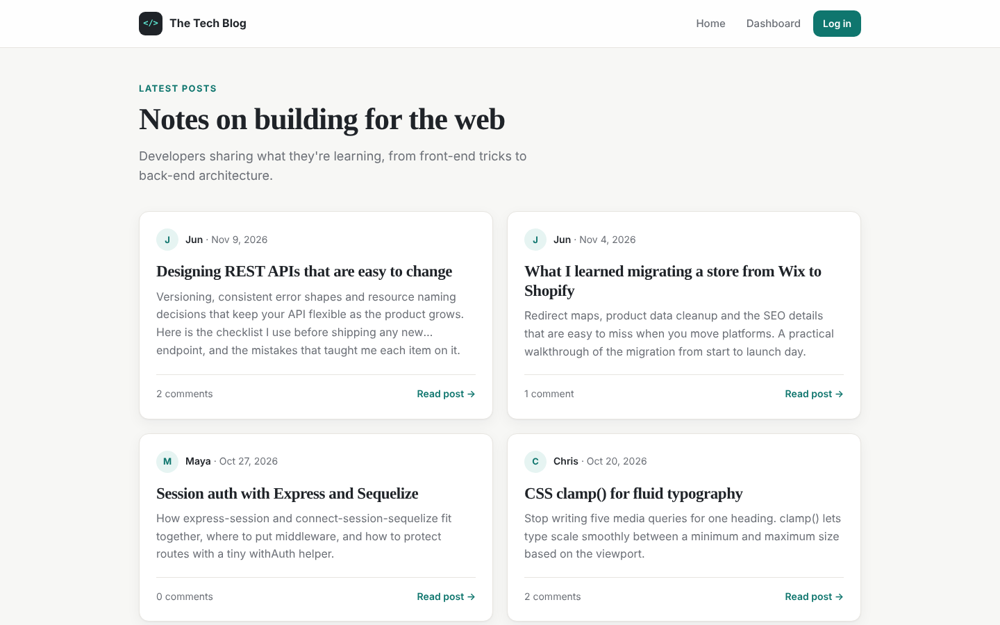

# The Tech Blog

A CMS-style blog where developers publish posts and comment on each other's work. Built with the MVC pattern: Express routes, Handlebars views and Sequelize models.



## Features

- Home feed of posts with author, date and comment count
- Sign up, log in and log out with hashed passwords (bcrypt) and server-side sessions
- Dashboard to create, edit and delete your own posts
- Comments on posts for signed-in users
- Protected routes with a small `withAuth` middleware
- Responsive, accessible UI

## Built with

Node.js, Express, Handlebars, Sequelize (MySQL), express-session, connect-session-sequelize, bcrypt.

## Run locally

1. Create a MySQL database named `tech_blog_db`.
2. Add a `.env` file:
   ```
   DB_NAME=tech_blog_db
   DB_USER=root
   DB_PW=your_password
   SESSION_SECRET=any_long_random_string
   ```
3. Install, seed and start:
   ```bash
   npm install
   npm run seeds
   npm start
   ```
4. Open http://localhost:3001. Seeded users (John, Jake, Joe) use the password `password123`.
